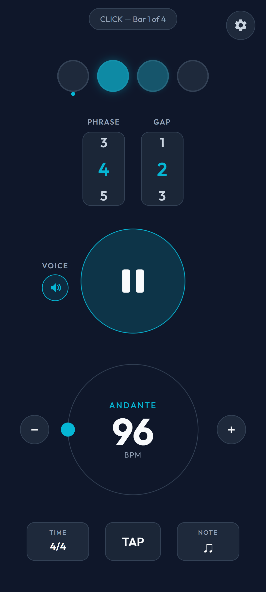
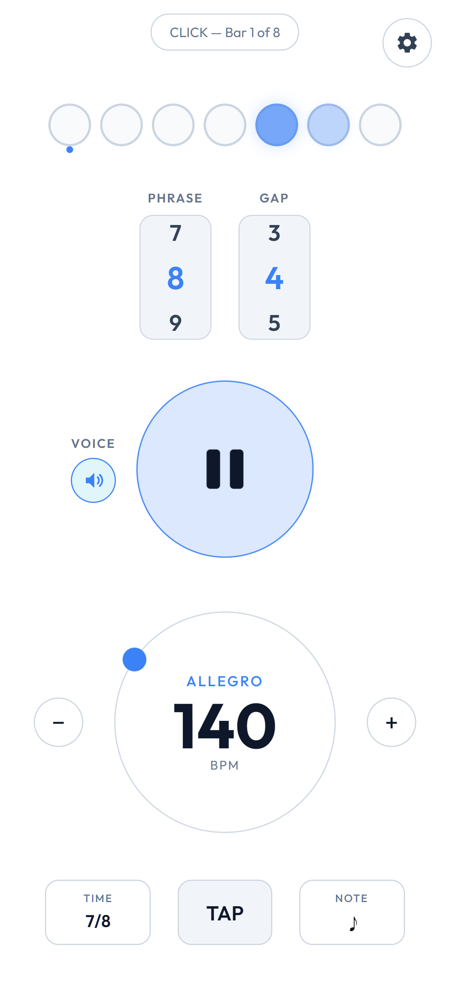
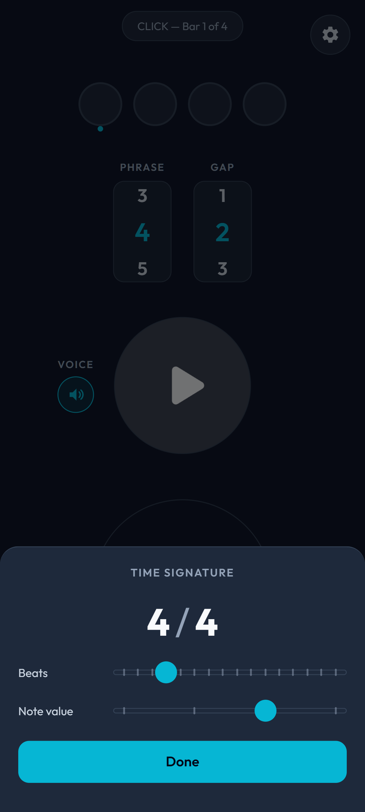
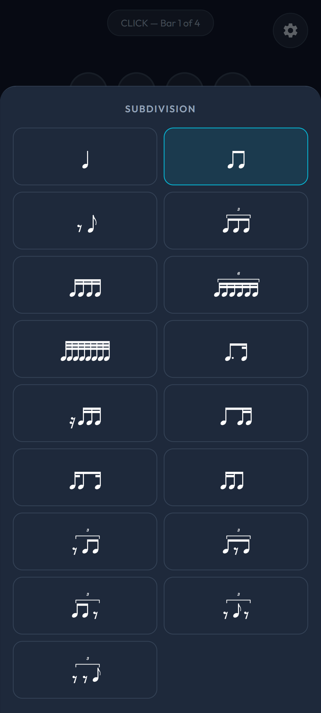
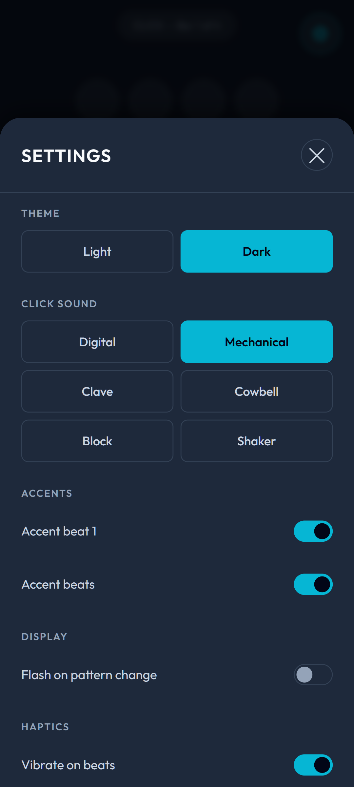

# Gap Metronome

A practice metronome for Android built around **gap training**: it clicks for the first bars of a phrase and goes silent for the rest, so you learn to keep time on your own.

<p>
  
  
  
  
  
</p>

## Download

**[Get the latest APK from Releases](https://github.com/Feijix/metronome/releases/latest)** (Android 7.0 or newer).

To get updates automatically, install [Obtainium](https://github.com/ImranR98/Obtainium), tap **Add App** and paste:

```
https://github.com/Feijix/metronome
```

## Features

**Gap training**
- Phrase of 1–16 bars, with any number of silent bars at the end
- Voice count speaks the bar number so you always know where you are
- Optional screen flash when the phrase switches between click and silence

**Metronome**
- 20–400 BPM: rotary dial, +/− buttons and tap tempo
- Time signatures from 1 to 16 beats over a whole, half, quarter or eighth note
- 17 subdivisions, including triplets, sextuplets, 32nds, dotted eighths, offbeats and gapped patterns
- Tap a beat to mute it; accent beat 1 and the main beats
- Six click sounds: Digital, Mechanical, Clave, Cowbell, Block, Shaker

**Everyday use**
- Keeps playing with the screen off, with play/pause in the notification
- Vibrate on beats, keep-screen-awake option
- Presets, light and dark themes

No ads, no accounts, no analytics.

## Building

Requires Node.js and the Android SDK (Android Studio).

```
npm install
npm run sync          # copy web files into www/ and sync the Android project
npm run deploy        # build a debug APK and install it on a connected device
cd android && ./gradlew assembleRelease   # release APK (needs android/keystore.properties)
```

The app is plain HTML/CSS/JavaScript (`index.html`, `css/`, `js/`) wrapped with [Capacitor](https://capacitorjs.com/). Native Android code for background playback lives in `android/app/src/main/java`.

## License

[MIT](LICENSE). Bundled assets: the Bravura music font is under the SIL Open Font License (`assets/fonts/OFL.txt`); click sounds are public domain or generated in-repo (`assets/sounds/CREDITS.md`).
